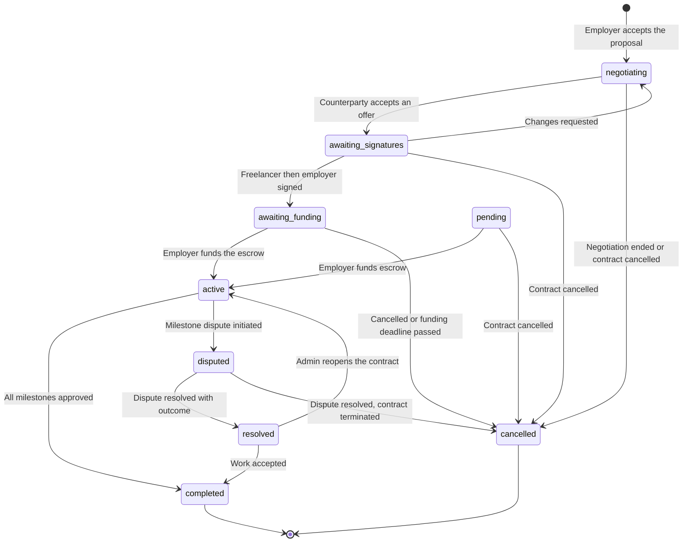
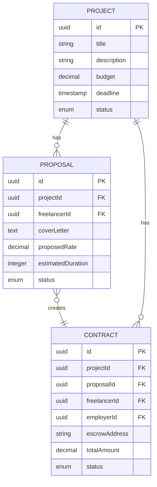
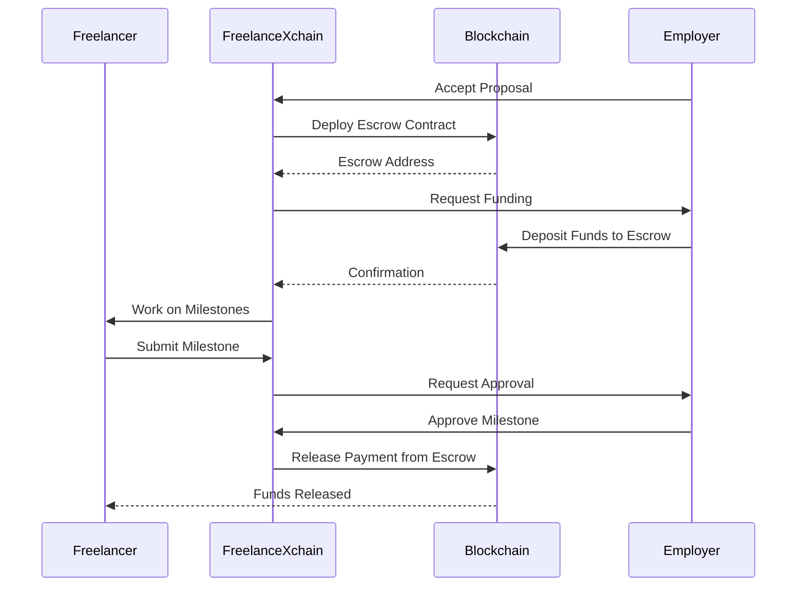

# Contract API

## Table of Contents

1. [Introduction](#introduction)
2. [API Endpoints](#api-endpoints)
   - [List User Contracts](#list-user-contracts)
   - [Get Contract Details](#get-contract-details)
   - [Fund Contract Escrow](#fund-contract-escrow)
   - [Get Contract Funding Info](#get-contract-funding-info)
   - [Get Pending Escrow Withdrawals](#get-pending-escrow-withdrawals)
   - [Withdraw from Escrow](#withdraw-from-escrow)
   - [Cancel Contract](#cancel-contract)
   - [List Contract Disputes](#list-contract-disputes)
3. [Negotiation and E-Signature Endpoints](#negotiation-and-e-signature-endpoints)
   - [Get Negotiation State](#get-negotiation-state)
   - [Propose or Counter Terms](#propose-or-counter-terms)
   - [Accept, Decline or Withdraw an Offer](#accept-decline-or-withdraw-an-offer)
   - [Request Changes After Terms Are Locked](#request-changes-after-terms-are-locked)
   - [Get Signing Payload](#get-signing-payload)
   - [Sign the Contract](#sign-the-contract)
   - [List Signatures](#list-signatures)
4. [Contract Schema](#contract-schema)
5. [Contract Status Lifecycle](#contract-status-lifecycle)
6. [Relationships Between Contracts, Proposals, and Projects](#relationships-between-contracts-proposals-and-projects)
7. [Blockchain Escrow Integration](#blockchain-escrow-integration)
8. [Client Implementation Examples](#client-implementation-examples)
9. [Error Handling](#error-handling)

## Introduction

The Contract API provides access to contract data and lifecycle management within the FreelanceXchain system. Contracts are created when a proposal is accepted and represent formal agreements between freelancers and employers for project work. Accepting a proposal opens a negotiation: both parties agree on milestones, additional pay, deadline and rush fee (the freelancer's proposed rate is the minimum base amount), both sign the locked terms, and the employer then funds the escrow. This API allows users to retrieve their contract history, view detailed contract information, negotiate and sign terms, fund escrow, check and claim pending escrow withdrawals, cancel unfunded contracts, and view associated disputes. All endpoints require JWT authentication, with contract creation handled through the proposal acceptance workflow.

## API Endpoints

### List User Contracts

Retrieves all contracts for the authenticated user (as either freelancer or employer).

**HTTP Method**: GET  
**URL Pattern**: `/api/contracts`  
**Authentication**: JWT (Bearer token)  
**Parameters**:

- `limit` (integer, optional): Number of results per page (default: 20)
- `continuationToken` (string, optional): Token for pagination

**Response**:

```json
{
  "items": [
    {
      "id": "string",
      "projectId": "string",
      "proposalId": "string",
      "freelancerId": "string",
      "employerId": "string",
      "escrowAddress": "string",
      "baseAmount": number,
      "rushFee": number,
      "totalAmount": number,
      "status": "active",
      "createdAt": "string",
      "updatedAt": "string"
    }
  ],
  "hasMore": boolean,
  "continuationToken": "string"
}
```

**Status Codes**:

- 200: Contracts retrieved successfully
- 401: Unauthorized (missing or invalid JWT)

### Get Contract Details

Retrieves details of a specific contract.

**HTTP Method**: GET  
**URL Pattern**: `/api/contracts/{id}`  
**Authentication**: JWT (Bearer token)  
**Path Parameters**:

- `id` (string, required): Contract ID (UUID)

**Response**:

```json
{
  "id": "string",
  "projectId": "string",
  "proposalId": "string",
  "freelancerId": "string",
  "employerId": "string",
  "escrowAddress": "string",
  "baseAmount": number,
  "rushFee": number,
  "totalAmount": number,
  "status": "active",
  "title": "string",
  "description": "string",
  "startDate": "string",
  "endDate": "string",
  "milestones": [],
  "createdAt": "string",
  "updatedAt": "string"
}
```

**Status Codes**:

- 200: Contract retrieved successfully
- 400: Invalid UUID format
- 401: Unauthorized (missing or invalid JWT)
- 403: Forbidden (user is not the freelancer, employer, or admin)
- 404: Contract not found

### Fund Contract Escrow

Deploys and funds the escrow, activating the contract. A negotiated contract can be funded once both parties signed (`awaiting_funding`) and before its `fundingDeadline`; contracts created before negotiation existed are funded from `pending`. The escrow uses the contract's own negotiated milestones. Only the employer can fund the escrow. If the contract is already active and funded, returns a success response indicating no action was needed. Requires KYC verification.

**HTTP Method**: POST  
**URL Pattern**: `/api/contracts/{id}/fund`  
**Authentication**: JWT (Bearer token), KYC verified  
**Path Parameters**:

- `id` (string, required): Contract ID (UUID)

**Request Body** (optional):

```json
{
  "escrowAddress": "string",
  "transactionHash": "string"
}
```

- `escrowAddress` (string, optional): Pre-deployed escrow address from the frontend (MetaMask flow)
- `transactionHash` (string, optional): Transaction hash of the frontend-deployed escrow

If no `escrowAddress` is provided in the request body, the server deploys the escrow contract itself using the employer and freelancer wallet addresses.

**Response** (success):

```json
{
  "message": "Contract funded and activated",
  "escrowAddress": "string",
  "contractStatus": "active"
}
```

**Response** (already funded):

```json
{
  "message": "Contract already funded and active",
  "escrowAddress": "string",
  "contractStatus": "active"
}
```

**Status Codes**:

- 200: Escrow funded and contract activated (or already funded)
- 400: Contract not fundable yet (terms not agreed or not signed), missing wallet addresses, or associated project not found
- 401: Unauthorized (missing or invalid JWT)
- 403: Forbidden (only the employer can fund the escrow)
- 404: Contract not found
- 409: `FUNDING_DEADLINE_PASSED` — the signed contract was not funded in time

Activation also starts the first milestone and, once every hiring slot on the project is funded, rejects the remaining pending proposals and moves the project to `in_progress`.

### Get Contract Funding Info

Returns the data needed by the frontend to deploy the escrow contract via MetaMask. Only the employer can access this endpoint. Includes milestone amounts converted to wei, wallet addresses, and the platform wallet address.

**HTTP Method**: GET  
**URL Pattern**: `/api/contracts/{id}/fund-info`  
**Authentication**: JWT (Bearer token)  
**Path Parameters**:

- `id` (string, required): Contract ID (UUID)

**Response**:

```json
{
  "contractId": "string",
  "freelancerWallet": "string",
  "platformWallet": "string",
  "milestoneAmounts": ["string"],
  "milestoneDescriptions": ["string"],
  "totalAmount": "string"
}
```

**Field Descriptions**:

- `contractId`: The contract ID
- `freelancerWallet`: Freelancer's blockchain wallet address
- `platformWallet`: Platform's wallet address (used as arbiter for milestone approvals)
- `milestoneAmounts`: Array of milestone amounts in wei (strings)
- `milestoneDescriptions`: Array of milestone titles
- `totalAmount`: Total contract amount in wei (string)

**Status Codes**:

- 200: Funding info retrieved successfully
- 400: Missing wallet addresses or associated project not found
- 401: Unauthorized (missing or invalid JWT)
- 403: Forbidden (only the employer can view fund info)
- 404: Contract not found

### Get Pending Escrow Withdrawals

Returns the amounts credited to each party's pending withdrawals on the escrow contract after a dispute resolution (pull-payment pattern). Only meaningful when `BLOCKCHAIN_MODE=real`; otherwise returns `422`.

**HTTP Method**: GET  
**URL Pattern**: `/api/contracts/{id}/escrow/withdrawable`  
**Authentication**: JWT (Bearer token)  
**Path Parameters**:

- `id` (string, required): Contract ID (UUID)

**Response** (200):

```json
{
  "contractId": "string",
  "escrowAddress": "string",
  "pendingWithdrawals": {
    "platformWallet": "string",
    "platformAmount": "0",
    "freelancerWallet": "string",
    "freelancerAmount": "0"
  }
}
```

Amounts are returned as wei strings. The platform amount is claimable via `POST /api/contracts/{id}/escrow/withdraw`; the freelancer claims their own allocation directly from their wallet against the escrow contract.

**Status Codes**:

- 200: Pending withdrawal amounts retrieved
- 400: Contract has no escrow address (`ESCROW_NOT_FOUND`)
- 401: Unauthorized (missing or invalid JWT)
- 403: User is not a party to the contract
- 404: Contract not found
- 422: Only available in real blockchain mode (`ESCROW_WITHDRAW_UNAVAILABLE`)
- 500: Failed to fetch pending withdrawals

### Withdraw from Escrow

Claims the platform's pending escrow allocation after a dispute resolution. The server wallet is the on-chain employer/platform, so only the employer (or an admin) can trigger this — freelancers must claim their allocation from their own wallet via the escrow contract's `withdraw()`. Requires KYC verification and `BLOCKCHAIN_MODE=real`.

**HTTP Method**: POST  
**URL Pattern**: `/api/contracts/{id}/escrow/withdraw`  
**Authentication**: JWT (Bearer token), KYC verified  
**Path Parameters**:

- `id` (string, required): Contract ID (UUID)

**Request Body**: none (an empty body is enforced; stray request bodies are rejected with `400 VALIDATION_ERROR`)

**Response** (200):

```json
{
  "message": "Escrow withdrawal processed",
  "transactionHash": "string",
  "timestamp": "string",
  "requestId": "string"
}
```

**Status Codes**:

- 200: Withdrawal processed (transaction hash returned)
- 400: Contract has no escrow address (`ESCROW_NOT_FOUND`), or non-empty request body
- 401: Unauthorized (missing or invalid JWT)
- 403: Only the employer (or an admin) can trigger the platform withdrawal
- 404: Contract not found
- 422: Only available in real blockchain mode (`ESCROW_WITHDRAW_UNAVAILABLE`)
- 500: Withdrawal failed (`WITHDRAW_FAILED`)

### Cancel Contract

Cancels a contract before it is funded (`negotiating`, `awaiting_signatures`, `awaiting_funding` or `pending`). The proposal leaves the accepted state and the project slot is released so the employer can hire someone else. Requires KYC verification. Only parties to the contract (freelancer or employer) can cancel it.

**HTTP Method**: POST  
**URL Pattern**: `/api/contracts/{id}/cancel`  
**Authentication**: JWT (Bearer token), KYC verified  
**Path Parameters**:

- `id` (string, required): Contract ID (UUID)

**Response**:

```json
{
  "message": "Contract cancelled successfully"
}
```

**Status Codes**:

- 200: Contract cancelled successfully
- 400: Contract cannot be cancelled (already funded)
- 401: Unauthorized (missing or invalid JWT)
- 403: Forbidden (user is not authorized to cancel this contract)
- 404: Contract not found

### List Contract Disputes

Retrieves all disputes associated with a contract. Only parties to the contract (freelancer or employer) can view disputes.

**HTTP Method**: GET  
**URL Pattern**: `/api/contracts/{contractId}/disputes`  
**Authentication**: JWT (Bearer token)  
**Path Parameters**:

- `contractId` (string, required): Contract ID (UUID)

**Response**:

```json
[
  {
    "id": "string",
    "contractId": "string",
    "initiatorId": "string",
    "reason": "string",
    "status": "string",
    "resolution": "string",
    "createdAt": "string",
    "updatedAt": "string"
  }
]
```

**Status Codes**:

- 200: Disputes retrieved successfully
- 401: Unauthorized (missing or invalid JWT)
- 403: Forbidden (user is not authorized to view disputes for this contract)
- 404: Contract not found

## Negotiation and E-Signature Endpoints

These endpoints cover the steps between accepting a proposal and funding the escrow. All of them require JWT authentication; write endpoints also require KYC verification. Only the two contract parties can act (admins get a read-only view of the negotiation state and signatures).

### Get Negotiation State

**HTTP Method**: GET  
**URL Pattern**: `/api/contracts/{id}/negotiation`

Returns the contract, the freelancer's floor (`floor.proposedRate`), the project template (posted milestones, deadline, rush settings), every offer (oldest first), the open offer, the caller's permissions (`canPropose`, `canAccept`, `canDecline`, `canWithdraw`, `canEnd`, `canReopen`), negotiation limits and the chat target (`chat.otherPartyId`, `chat.projectId`) used to open the existing conversation.

When a proposal is accepted the system creates a round-1 offer from the project posting on the employer's behalf (`isSeed: true`), so the freelancer can accept the posted terms in one step.

### Propose or Counter Terms

**HTTP Method**: POST  
**URL Pattern**: `/api/contracts/{id}/offers`

```json
{
  "baseAmount": 2,
  "additionalPay": 0.5,
  "isRush": false,
  "rushFeePercentage": 0,
  "deadline": "2026-12-31",
  "message": "Added a QA milestone",
  "milestones": [
    { "title": "Design", "description": "Mockups", "amount": 1, "dueDate": "2026-11-15" },
    { "title": "Build", "amount": 1.5, "dueDate": "2026-12-15" }
  ]
}
```

Rules enforced by the server:

- `baseAmount` must be at least the freelancer's proposed rate (`FLOOR_VIOLATION`)
- the rush fee is `baseAmount × rushFeePercentage / 100`; the total is `baseAmount + additionalPay + rushFee`
- milestone amounts must add up to the total exactly (`AMOUNT_MISMATCH`)
- amounts use at most 2 decimals; 1–20 milestones; due dates are in the future, in order, and on or before the deadline

Sending an offer while the other party's offer is open marks theirs `countered`; re-sending your own marks the previous one `superseded`. Status codes: 201, 400 (invalid terms), 403, 409 (not negotiating or offer limit reached).

### Accept, Decline or Withdraw an Offer

| Method | URL | Body | Effect |
| --- | --- | --- | --- |
| POST | `/api/contracts/{id}/offers/{offerId}/accept` | none | Only the other party can accept. Locks the terms: milestones are written to the contract, the EIP-712 terms hash is recorded and the contract moves to `awaiting_signatures`. Both parties need a linked wallet. |
| POST | `/api/contracts/{id}/offers/{offerId}/decline` | `{ "reason"?: string, "endNegotiation"?: boolean }` | Declining keeps the negotiation open. With `endNegotiation: true` the contract is cancelled and the slot released. |
| POST | `/api/contracts/{id}/offers/{offerId}/withdraw` | none | The proposer withdraws their own open offer. |

### Request Changes After Terms Are Locked

**HTTP Method**: POST  
**URL Pattern**: `/api/contracts/{id}/negotiation/reopen`

Moves an `awaiting_signatures` contract back to `negotiating`, voids any signature and clears the locked terms.

### Get Signing Payload

**HTTP Method**: GET  
**URL Pattern**: `/api/contracts/{id}/signing-payload`

Returns the canonical terms, `termsHash`, the EIP-712 typed data for the caller's role (`typedData`), the chain id, the versioned legal clauses and consent statement, the valid signatures and `nextSigner`. Returns 409 `TERMS_NOT_LOCKED` before terms are agreed.

### Sign the Contract

**HTTP Method**: POST  
**URL Pattern**: `/api/contracts/{id}/signatures`

```json
{
  "termsHash": "0x…",
  "signatureType": "drawn",
  "signatureImage": "data:image/png;base64,…",
  "typedName": "Fred Freelancer",
  "walletAddress": "0x…",
  "walletSignature": "0x…",
  "consent": true
}
```

Each signature combines an adopted signature (a drawn PNG up to 100 KB, or a typed name) with an EIP-712 wallet signature over the same terms. The server verifies that the wallet signature recovers to the signer's linked wallet and that `termsHash` matches the locked terms, and stores the signature with timestamp, IP address and user agent.

The freelancer signs first. The employer's signature moves the contract to `awaiting_funding` and sets `fundingDeadline` (72 hours by default, `CONTRACT_FUNDING_DEADLINE_HOURS`). Status codes: 201, 400 (`INVALID_SIGNATURE`, `CONSENT_REQUIRED`, `SIGNATURE_INVALID`), 409 (`FREELANCER_SIGNATURE_REQUIRED`, `ALREADY_SIGNED`, `TERMS_HASH_MISMATCH`, `WALLET_CHANGED`).

### List Signatures

**HTTP Method**: GET  
**URL Pattern**: `/api/contracts/{id}/signatures`

Valid signatures over the current terms. IP address and user agent are included only for your own signature (and for admins).

## Contract Schema

The contract object represents a formal agreement between a freelancer and employer for project work. Contracts are created when a proposal is accepted and contain references to the associated project, proposal, and parties involved.

```json
{
  "id": "string",
  "projectId": "string",
  "proposalId": "string",
  "freelancerId": "string",
  "employerId": "string",
  "escrowAddress": "string",
  "baseAmount": number,
  "rushFee": number,
  "totalAmount": number,
  "status": "active",
  "title": "string",
  "description": "string",
  "startDate": "string",
  "endDate": "string",
  "milestones": [],
  "createdAt": "string",
  "updatedAt": "string"
}
```

**Field Descriptions**:

- `id`: Unique identifier for the contract (UUID)
- `projectId`: Reference to the associated project
- `proposalId`: Reference to the accepted proposal that created this contract
- `freelancerId`: ID of the freelancer party
- `employerId`: ID of the employer party
- `escrowAddress`: Blockchain address of the escrow contract holding funds
- `baseAmount`: Base contract amount before rush fees (in ETH)
- `rushFee`: Additional fee for rush delivery (in ETH, 0 if standard timeline)
- `totalAmount`: Total contract value in ETH (baseAmount + rushFee). The server converts this to wei when interacting with the blockchain escrow contract.
- `status`: Current status of the contract (negotiating, awaiting_signatures, awaiting_funding, pending, active, completed, disputed, resolved, cancelled)
- `milestoneSource`: `contract` when the milestones were negotiated for this contract (absent on older contracts, which use the project's milestones)
- `additionalPay`, `rushFeePercentage`, `deadline`: Negotiated terms
- `termsHash`: EIP-712 hash of the locked terms both parties sign
- `fullySignedAt`, `fundingDeadline`, `fundedAt`: Signing and funding timestamps
- `cancelReason`: `cancelled_by_party`, `negotiation_ended` or `funding_expired` when cancelled before funding
- `title`: Optional contract title (typically derived from the associated project)
- `description`: Optional contract description
- `startDate`: Optional contract start date
- `endDate`: Optional contract end date
- `milestones`: Optional array of milestone objects
- `createdAt`: Timestamp when the contract was created
- `updatedAt`: Timestamp when the contract was last updated

## Contract Status Lifecycle

Accepting a proposal creates the contract in `negotiating`. The valid statuses are: `negotiating`, `awaiting_signatures`, `awaiting_funding`, `pending` (contracts created before negotiation was introduced), `active`, `completed`, `disputed`, `resolved`, and `cancelled`.



**State Transition Rules**:

| From | To | Who |
| --- | --- | --- |
| `negotiating` | `awaiting_signatures` | System, when the counterparty accepts an offer |
| `negotiating` | `cancelled` | Either party (ends the negotiation) |
| `awaiting_signatures` | `negotiating` | Either party (request changes; signatures are voided) |
| `awaiting_signatures` | `awaiting_funding` | System, when the employer's signature is verified |
| `awaiting_signatures` | `cancelled` | Either party |
| `awaiting_funding` | `active` | Employer (funds the escrow) |
| `awaiting_funding` | `cancelled` | Either party, or the system when the funding deadline passes |
| `pending` | `active` / `cancelled` | Employer funds / either party cancels |
| `active` | `completed` / `disputed` | Employer / either party |
| `disputed` | `resolved` / `cancelled` | Admin |
| `resolved` | `active` / `completed` / `cancelled` | Admin / employer / admin |

System transitions cannot be requested through the generic status update; they only happen as part of the offer, signature and funding-deadline flows.

A contract holds one of the project's hiring slots from acceptance until it is cancelled. Cancelling before funding (including an expired funding deadline, checked every 5 minutes) releases the slot. The employer receives a reminder when less than 24 hours of the funding window remain.

## Relationships Between Contracts, Proposals, and Projects

Contracts are created through a workflow that begins with project creation, followed by proposal submission, and finalized by proposal acceptance. This creates a hierarchical relationship between these entities.



**Workflow**:

1. Employer creates a project
2. Freelancer submits a proposal for the project
3. Employer accepts the proposal; the system creates a contract in `negotiating` with a round-1 offer from the project posting
4. The parties exchange offers until one is accepted (`awaiting_signatures`)
5. The freelancer signs, then the employer signs (`awaiting_funding`)
6. The employer funds the escrow before the funding deadline and the contract becomes `active`

## Blockchain Escrow Integration

Each contract is linked to a blockchain escrow address where funds are held securely. The escrow contract manages fund release according to milestone completion.



**Key Points**:

- Escrow address is stored in the contract's `escrowAddress` field
- Funds are deposited by the employer to the escrow address
- Payments are released to the freelancer upon milestone approval
- The escrow contract ensures funds are only released according to agreed terms

## Client Implementation Examples

### Retrieve User's Contract History

```javascript
// Example using fetch API
async function getUserContracts(limit = 20, continuationToken = null) {
  const url = new URL('/api/contracts', API_BASE_URL);
  if (limit) url.searchParams.append('limit', limit);
  if (continuationToken) url.searchParams.append('continuationToken', continuationToken);

  const response = await fetch(url, {
    method: 'GET',
    headers: {
      'Authorization': `Bearer ${jwtToken}`,
      'Content-Type': 'application/json'
    }
  });

  if (!response.ok) {
    throw new Error(`HTTP error! status: ${response.status}`);
  }

  return await response.json();
}

// Usage
const contractsData = await getUserContracts(10);
console.log('Contracts:', contractsData.items);
console.log('Has more:', contractsData.hasMore);
```

### Display Specific Contract Details

```javascript
// Example using async/await
async function getContractDetails(contractId) {
  const response = await fetch(`/api/contracts/${contractId}`, {
    method: 'GET',
    headers: {
      'Authorization': `Bearer ${jwtToken}`,
      'Content-Type': 'application/json'
    }
  });

  if (!response.ok) {
    if (response.status === 404) {
      throw new Error('Contract not found');
    }
    throw new Error(`Failed to fetch contract: ${response.status}`);
  }

  return await response.json();
}

// Usage
try {
  const contract = await getContractDetails('a1b2c3d4-e5f6-7890-g1h2-i3j4k5l6m7n8');
  displayContract(contract);
} catch (error) {
  console.error('Error fetching contract:', error.message);
}
```

## Error Handling

The Contract API follows a consistent error response format for all endpoints.

**Error Response Format**:

```json
{
  "error": {
    "code": "string",
    "message": "string"
  },
  "timestamp": "string",
  "requestId": "string"
}
```

**Common Error Codes**:

- `AUTH_UNAUTHORIZED`: User not authenticated (401)
- `UNAUTHORIZED`: User not authorized to perform this action (403)
- `FORBIDDEN`: User lacks permission for this resource (403)
- `NOT_FOUND`: Contract not found (404)
- `INVALID_UUID_FORMAT`: Invalid UUID format (400)
- `INVALID_STATUS`: Contract is not in the required status for this operation (400)
- `INVALID_STATUS_TRANSITION`: The requested status change is not allowed (400)
- `ESCROW_FAILED`: Failed to initialize escrow contract (500)
- `ACTIVATION_FAILED`: Escrow funded but contract activation failed (500)
- `CANCEL_FAILED`: Failed to cancel contract (400)
- `PROJECT_NOT_FOUND`: Associated project not found (400)
- `INTERNAL_ERROR`: Internal server error (500)

All error responses include a timestamp and request ID for debugging purposes.

---

[← Back to API Reference](README.md)
